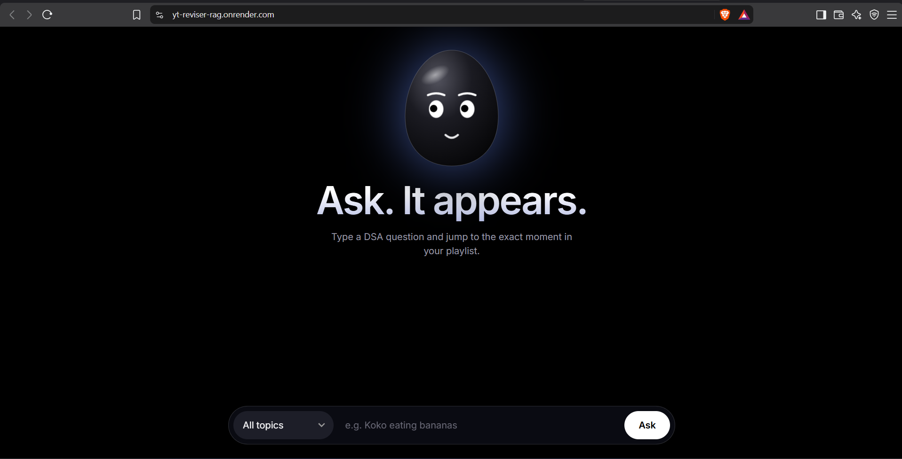

# YT Reviser

Ask a question about a DSA topic and get the exact video and timestamp in a ([YouTube playlist](https://youtube.com/playlist?list=PLbJhGqY-mq47k_WLUtzVjmarUm1EuXPj2&si=QQ7Qd1TgiKQH3HDF)) that explains it, for example "Koko eating bananas". The app searches the transcripts of 100+ lectures, picks the best matches, and links straight to the right moment.

Built on the DSA playlist by ([Padho with Pratyush](https://youtube.com/@padho_with_pratyush?si=v6yP2pG-7kkjTfad)), all credit for the lectures goes to the creator.

**Live demo:** [yt-reviser-rag.onrender.com](https://yt-reviser-rag.onrender.com/) (the free backend sleeps when idle, so the first request can take about a minute)



## Features

- Semantic search over about 10,000 transcript chunks, not just keyword matching
- Results ranked by an LLM: the video it recommends is always shown first, and nothing is shown when no video fits
- Clickable result cards with YouTube thumbnails, titles and a link that opens the video at the right timestamp
- Topic filter (Binary Search, Linked List, Dynamic Programming, ...) built from the categories stored in the database
- Animated assistant face whose expression changes while it listens, searches and answers

## How it works

```
YouTube playlist
   │  yt-dlp (video list + audio)
   ▼
faster-whisper large-v3 (GPU) ── Hindi/Hinglish speech → English text with timestamps
   │
   ▼
Keyword rules on titles → category per video
   │
   ▼
Chunking (~80 words, 1-segment overlap) → knowledge.jsonl
   │  Qdrant Cloud Inference (all-MiniLM-L6-v2, 384 dims, cosine)
   ▼
Qdrant Cloud collection (category payload index)

User question ─► FastAPI ─► Qdrant top 5 chunks ─► Groq (openai/gpt-oss-120b) picks and orders the relevant ones
                                                      │
                                         up to 3 ranked videos ─► web UI
```

## Tech stack

| Part | Tools |
|---|---|
| Transcription | yt-dlp, faster-whisper (large-v3, CUDA) |
| Vector database | Qdrant Cloud (free tier) with Cloud Inference embeddings |
| LLM | Groq, `openai/gpt-oss-120b` |
| Backend | Python, FastAPI, uvicorn |
| Frontend | Plain HTML, CSS and JavaScript (single file) |
| Hosting | Render (web service and static site) |

## Project structure

```
backend/
  main.py                    FastAPI app and routes
  src/rag.py                 search, LLM ranking, response building
  scripts/
    01_build_video_list.py   playlist → data/videos.csv
    02_transcribe.py         audio → English transcript with timestamps
    02b_categorize.py        assigns a category to each video from its title
    03_chunk.py              transcripts → data/knowledge.jsonl
    04_upload_cloud.py       embeds and uploads chunks to Qdrant Cloud
  requirements.txt           dependencies for the deployed server
frontend/
  index.html                 the whole UI
```

## API

| Method | Path | Description |
|---|---|---|
| GET | `/health` | health check |
| GET | `/categories` | list of available categories |
| POST | `/ask` | `{"question": "...", "category": "Binary Search"}` (category is optional) |

`/ask` returns an `answer` line (title and timestamp) and a ranked `sources` list with title, category, timestamp, link, thumbnail and transcript text. `sources` is empty when no video matches.

## Run locally

Create `backend/.env`:

```
GROQ_API_KEY=...
QDRANT_URL=https://<your-cluster>.cloud.qdrant.io:6333
QDRANT_API_KEY=...
```

Build the data once (run from `backend/`, with a GPU for step 2):

```bash
uv run python scripts/01_build_video_list.py   # set PLAYLIST_URL inside first
uv run python scripts/02_transcribe.py
uv run python scripts/02b_categorize.py --save
uv run python scripts/03_chunk.py
uv run python scripts/04_upload_cloud.py
```

Start the API and the page:

```bash
cd backend && uv run uvicorn main:app --reload --port 8000
cd frontend && python -m http.server 5173     # then open http://localhost:5173
```

## Deploy

- **Backend:** Render web service, root directory `backend`, build command `pip install -r requirements.txt`, start command `uvicorn main:app --host 0.0.0.0 --port $PORT`. Environment variables: `GROQ_API_KEY`, `QDRANT_URL`, `QDRANT_API_KEY`, and `FRONTEND_ORIGINS` (the static site's address).
- **Frontend:** Render static site, root directory `frontend`, publish directory `.`. Set the `API` constant in `index.html` to the backend's address.

## Limitations

- Whisper's English translation of Hinglish is good but not perfect, so some technical words may be misspelled in the transcripts.
- Categories come from keyword rules on video titles, so an unusual title can land in the wrong category.
- On the free tiers the backend sleeps after 15 minutes of inactivity, and the Qdrant cluster suspends after a week without use.

## Notes

The videos belong to their creators. The transcripts are kept out of this repository (`backend/data/` is git-ignored), and the app only links back to the original videos.